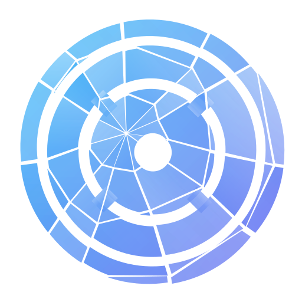
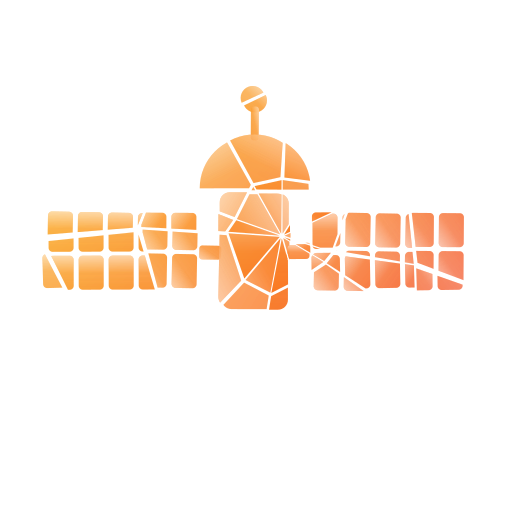
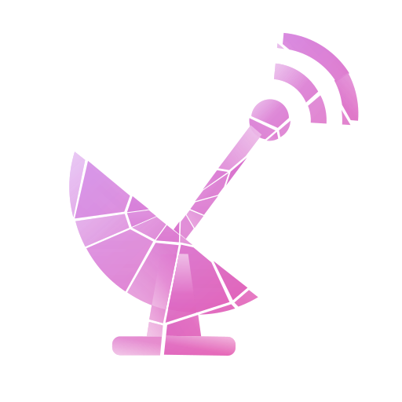

<picture>
  <source media="(prefers-color-scheme: dark)" srcset="docs/assets/header-dark.svg">
  
</picture>

Four Go projects for running agents in production, each useful on its own and built to fit together. Everything is free and open source under Apache-2.0: there is no paid edition and no feature held back.

| Project | What it does |
|---|---|
|  [airlock](https://github.com/raven-clown/airlock) | MCP gateway: one front door for many MCP servers, with login, permissions, audit log and rate limits |
|  [rosetta](https://github.com/raven-clown/rosetta) | Protocol bridge: write an agent once, serve it over MCP, A2A, ACP and AG-UI |
|  [transponder](https://github.com/raven-clown/transponder) | LLM gateway: one API in front of Anthropic, OpenAI, Gemini and Ollama, with fallback and cost tracking |
|  [logbook](https://github.com/raven-clown/logbook) | Agent memory: a shared memory any agent can read and write, served as an MCP server |

## How it works

<picture>
  <source media="(prefers-color-scheme: dark)" srcset="docs/assets/how-it-works-dark.svg">
  
</picture>

This repository holds what the four share:

- [CONTRACT.md](CONTRACT.md): how the projects connect, and the conventions they all follow
- [contributing/](contributing): the contributing guide, templates, CI workflows, lint and coverage settings, and merge rules every repository copies
- a Docker Compose file that runs all four together, and an end-to-end test, once the projects have their first releases

All four have early releases, v0.1.x. Questions and ideas are welcome in Discussions.
