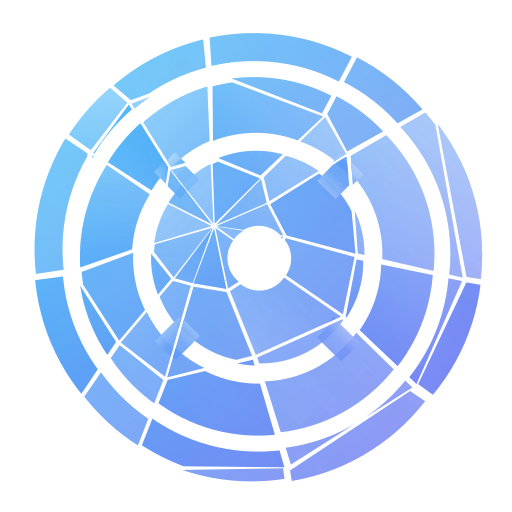
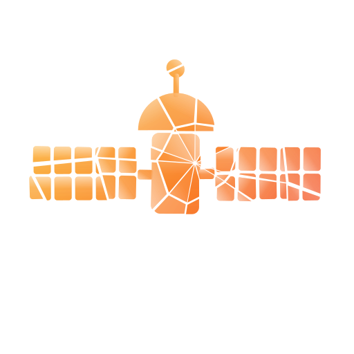
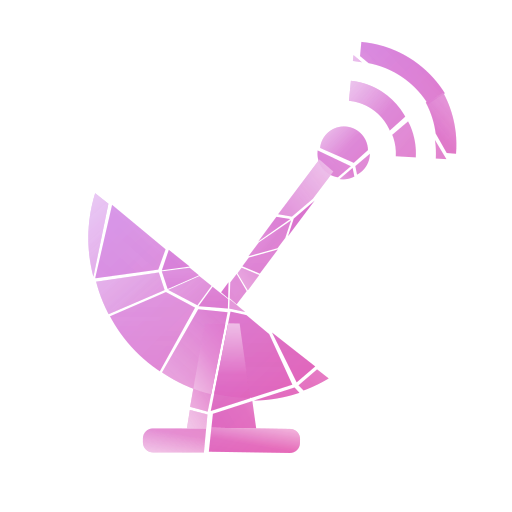

<picture>
  <source media="(prefers-color-scheme: dark)" srcset="docs/assets/header-dark.svg">
  
</picture>

<div align="center">

[](LICENSE)
[](https://scorecard.dev/viewer/?uri=github.com/raven-clown/mothership)

</div>

Four Go projects for running agents in production, each useful on its own and built to fit together. Everything is free and open source under Apache-2.0: there is no paid edition and no feature held back.

| Project | What it does |
|---|---|
|  [airlock](https://github.com/raven-clown/airlock) | MCP gateway: one front door for many MCP servers, with login, permissions, audit log and rate limits |
|  [rosetta](https://github.com/raven-clown/rosetta) | Protocol bridge: write an agent once, serve it over MCP, A2A, ACP and AG-UI |
|  [transponder](https://github.com/raven-clown/transponder) | LLM gateway: one API in front of Anthropic, OpenAI, Gemini and Ollama, with fallback and cost tracking |
|  [logbook](https://github.com/raven-clown/logbook) | Agent memory: a shared memory any agent can read and write, served as an MCP server |

## How it works

<picture>
  <source media="(prefers-color-scheme: dark)" srcset="docs/assets/how-it-works-dark.svg">
  
</picture>

This repository holds what the four share:

- [CONTRACT.md](CONTRACT.md): how the projects connect, and the conventions they all follow
- [contributing/](contributing): the contributing guide, templates, CI workflows, lint and coverage settings, and merge rules every repository copies
- [deploy/compose/](deploy/compose): a Docker Compose file that runs all four together
- [e2e/](e2e): an end-to-end test that walks the path in the diagram

## Run the whole stack

With Docker and Compose v2:

```shell
git clone https://github.com/raven-clown/mothership
cd mothership/deploy/compose
docker compose up --build --wait
```

The first start builds the four projects from their releases, which takes a few minutes. transponder answers with its built-in `echo` provider, so no API key is needed and nothing leaves your machine. Every port is bound to localhost:

| Service | URL | Demo key |
|---|---|---|
| rosetta, agent `assistant` | `http://127.0.0.1:4200` (`/mcp`, A2A, AG-UI) | `ros_demo_alice` |
| airlock, with logbook behind it | `http://127.0.0.1:4100/mcp` | `alk_demo_alice` |
| transponder | `http://127.0.0.1:4000/v1` | `tp_demo_alice` |
| logbook | `http://127.0.0.1:8420` | made at first start, in the `keys` volume |
| Jaeger, for the traces | `http://127.0.0.1:16686` | |

The keys are public and fit only for your own machine. Point an MCP client at rosetta's `/mcp` with `Authorization: Bearer ros_demo_alice` and call `assistant`, and the reply comes from transponder. To build a project from another tag or branch, set `AIRLOCK_REF`, `ROSETTA_REF`, `TRANSPONDER_REF` or `LOGBOOK_REF`, such as `TRANSPONDER_REF=main`.

With the stack up, run the end-to-end test:

```shell
cd ../../e2e
go test -tags e2e -count=1 -v ./...
```

It also runs on every pull request and every night. Steps the projects can't do yet are skipped with a link to the issue that tracks each one, so the skips are the list of what is left before the four fit together fully.

To stop the stack and remove its data, from `e2e`:

```shell
docker compose -f ../deploy/compose/compose.yaml down --volumes
```

All four have early releases, v0.1.x and up. Questions and ideas are welcome in Discussions.
